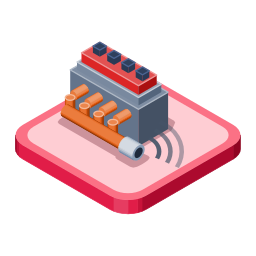
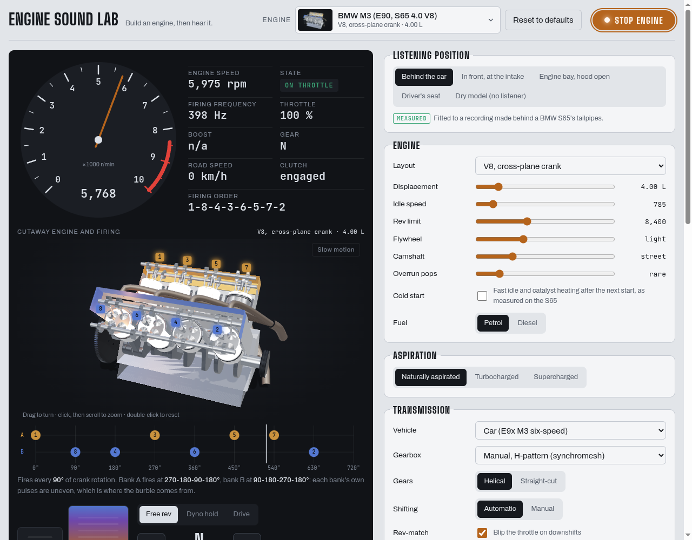
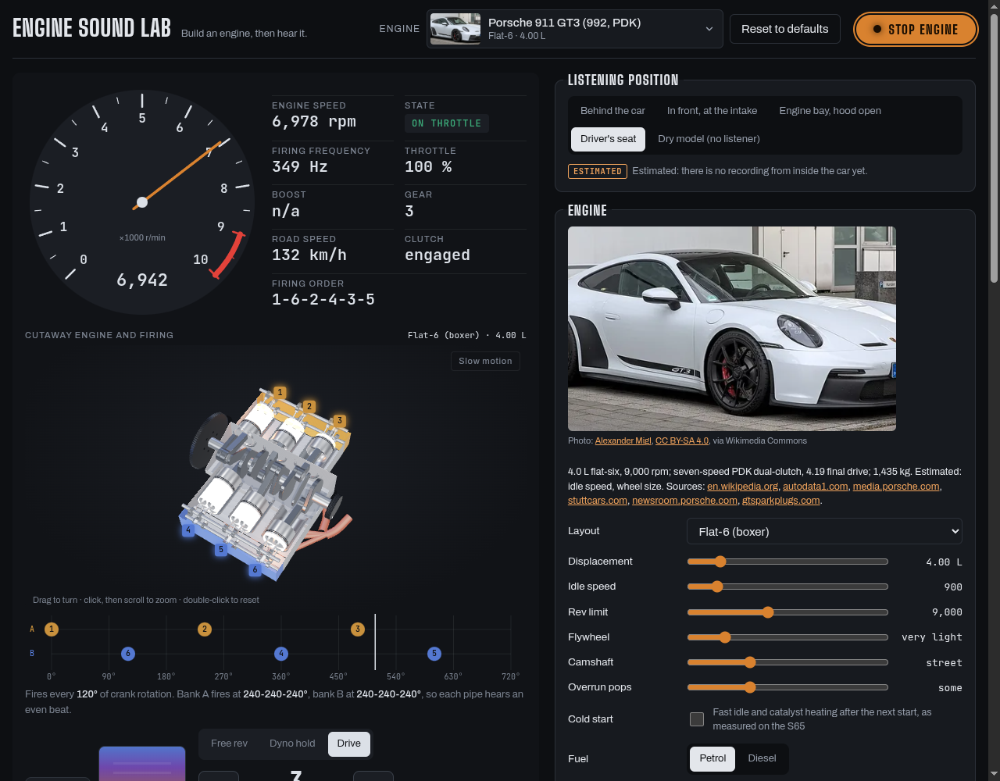
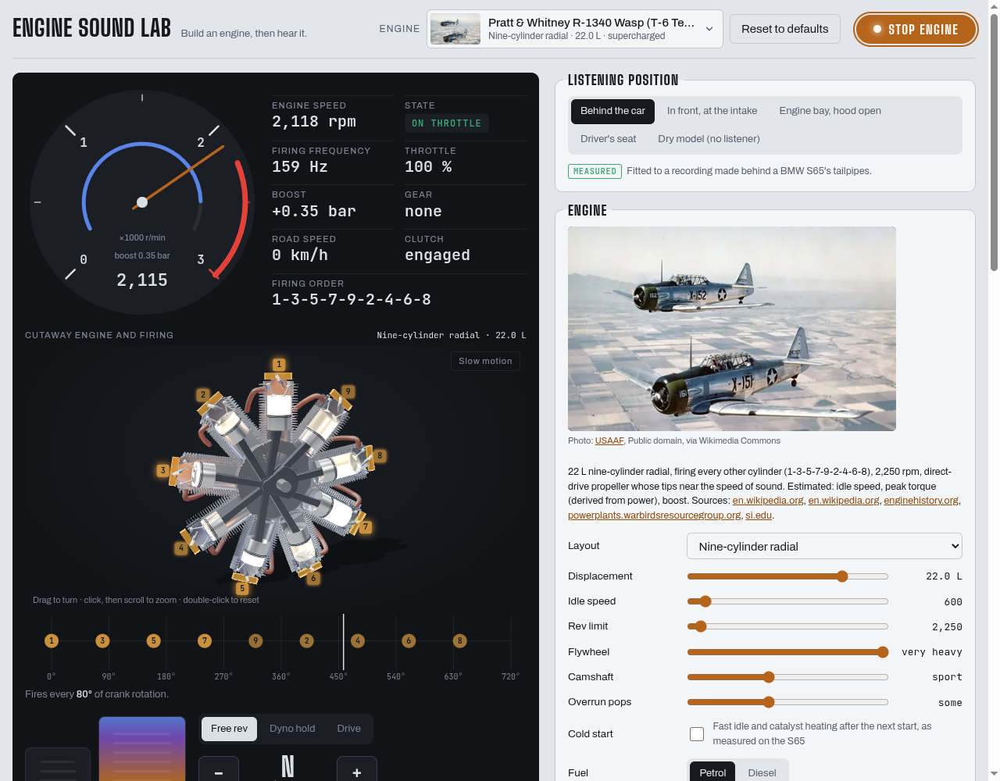
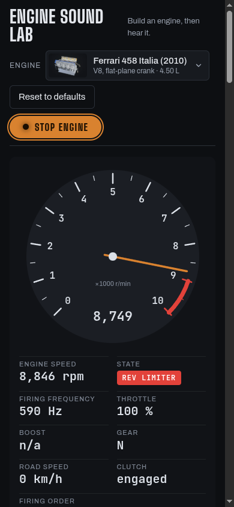
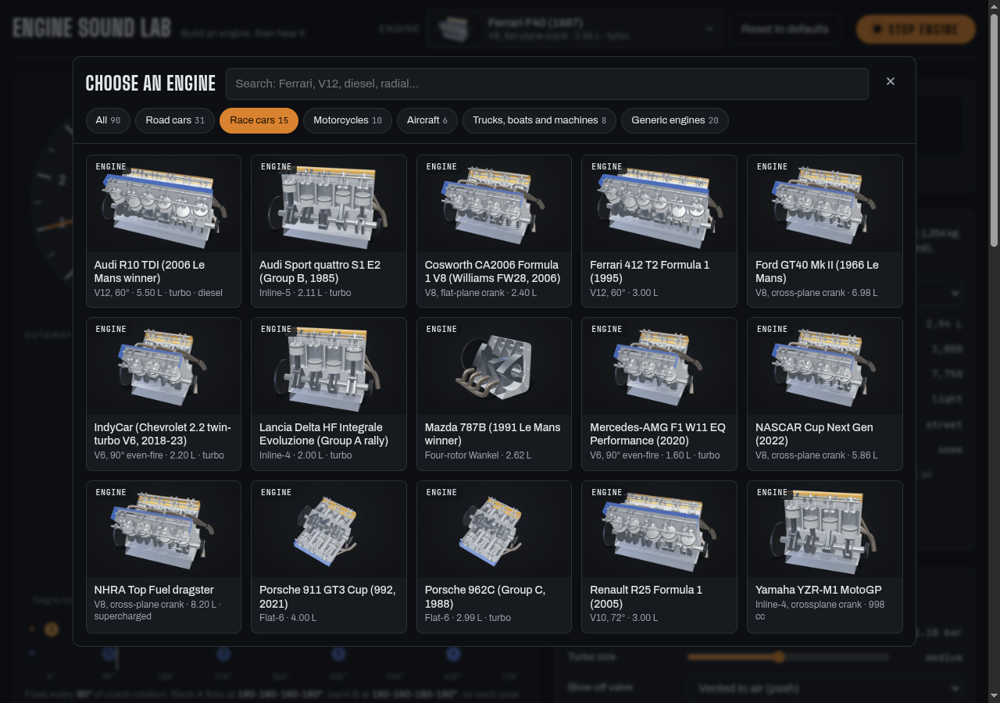

<p align="center">
  
</p>

# Engine Sound Lab

<!-- BADGES:START -->


[](LICENSE.md)
[](CONTRIBUTING.md)
<!-- BADGES:END -->

## Table of Contents

- [Description](#description)
- [Screenshots](#screenshots)
- [Features](#features)
- [Requirements](#requirements)
- [Installation](#installation)
- [Usage](#usage)
  - [Controls](#controls)
  - [Modes](#modes)
  - [Presets and listening positions](#presets-and-listening-positions)
  - [Recording a WAV](#recording-a-wav)
- [Deployment](#deployment)
- [Architecture](#architecture)
- [Credits](#credits)
- [Contributing](#contributing)
- [License](#license)

## Description

Build an internal combustion engine in the browser and hear it. Choose the layout, cylinder
count and firing order, displacement, rev limit, cam, fuel, turbo or supercharger, intake,
headers and exhaust, then rev it in neutral, hold it on a dyno, or drive it through a clutch
and gearbox with brakes and shift paddles. The sound is synthesized live from the engine's
own firing events; nothing is sampled.

It ships 90 presets: 70 real vehicles and engines with their published engine and
drivetrain configurations (a McLaren F1, a Ferrari F40, a Porsche Carrera GT, a 2005 Formula 1
V10, a Mazda 787B four-rotor, a Ducati 1299 Panigale, a B-17's Wright Cyclone radial, a
Peterbilt with an 18-speed, a Citroën 2CV, a chainsaw) and 20 generic engines, chosen from a
picker that shows each one as a 3D rendering. It runs live at
[engine-sound-lab.geoffmyers.com](https://engine-sound-lab.geoffmyers.com).

## Screenshots

<p align="center">
  
</p>

<p align="center"><em>A BMW S65 cross-plane V8 revving, heard from behind the car. Each bank fires unevenly (270-180-90-180°), which is where a cross-plane V8's burble comes from.</em></p>

<p align="center">
  
</p>

<p align="center"><em>A Porsche 911 GT3 accelerating in Drive, heard from the driver's seat, with its real specification and sources.</em></p>

<p align="center">
  
  
</p>

<p align="center"><em>Left: the T-6 Texan's Pratt &amp; Whitney R-1340 radial, firing 1-3-5-7-9-2-4-6-8. Right: a phone-sized screen.</em></p>

<p align="center">
  
</p>

<p align="center"><em>The preset picker, on the race cars: 90 presets in six categories plus generic engines, searchable by name, layout or fuel.</em></p>

These were captured in Chromium with the engine running (`scripts/capture-screenshots.mjs`;
the 3D engine needs a browser with a GPU, and `scripts/preview-3d.mjs` shoots a single preset).
They show the cards as this repository has them, each with a render of its own engine; the
live site also shows the cars as Gran Turismo 7 or GT6 draws them, where either has the car.

## Features

- **Firing events drive everything.** The crank angle advances sample by sample; at each
  cylinder's firing angle an exhaust pulse is made, shaped by rpm, load and cylinder size and
  delayed by that cylinder's header length. Cross-plane and flat-plane V8s, odd-fire V6s,
  boxers, V-twins, rotaries, two-strokes and a nine-cylinder radial all sound different for
  the reason they do in reality.
- **27 layouts**, published firing orders per preset, and exhaust routing per bank (one
  collector, an X-pipe, or true dual pipes in stereo).
- **Loud the way an engine is loud:** each exhaust and intake pulse carries one cylinder's
  charge, so as the pulses shorten with revs they get stronger, and an engine grows about
  18 dB from idle to full throttle near the limit, not just more frequent.
- **Exhaust, intake and the rest:** a muffler chamber and a waveguide tailpipe, airbox
  resonance and induction roar, valve clicks, diesel clatter, turbo whistle and blow-off,
  Roots, twin-screw and centrifugal supercharger whine, a starter motor, overrun pops (their
  own mixer channel), a cold start with fast idle, and propellers for the aircraft engines.
- **Drive it:** a clutch that slips or locks, a gearbox and final drive, the car's mass, drag,
  rolling resistance and brakes, with full traction (no wheelspin is simulated). Manual (clutch, synchro,
  clunk), sequential dog box (ignition-cut flat shifts) and dual-clutch gearboxes, with
  helical or straight-cut gear whine, rattle, shifter clicks, driveline shunt, road and wind.
- **Racing-style automatic shifting** (up at the limiter, down the moment the lower gear
  fits under the redline, rev-matched) or shift by hand; over-revving downshifts are refused.
- **70 real presets** with each engine's torque curve calibrated to its published peak
  torque and power, chosen from a **visual picker**: a card per preset with a 3D rendering
  (a render of the preset's own 3D engine; on the live site, the car as Gran Turismo 7 or,
  for cars only it has, GT6 draws it), with category tabs and search.
- **Listening positions:** behind the car, at the intake, in the engine bay (fitted to
  recordings of a real BMW S65), the driver's seat, or the dry model. Under load, all four
  were checked against the engine recordings in Gran Turismo 5, 6 and 7 (22 presets):
  cylinder-to-cylinder differences that grow with load, combustion noise from the block in
  the engine bay, and a supercharger whine heard mostly at the intake all came from that
  comparison. A review of related open-source engine synthesizers then fixed most of the
  high-frequency excess it found ([review](docs/2026-11-16-related-projects-review.md)).
- **3D cutaway engine:** pistons, connecting rods, crankshaft, camshafts and valves moving
  with the synthesizer's crank angle, castings cut open along each bank. The geometry is
  built from the layout's firing angles, so a cross-plane V8 grows a cross-plane crank, a
  60° V6 split crank pins, a boxer opposed throws, a radial one pin with a master rod hub,
  and a Wankel rotors turning at a third of shaft speed. Each chamber lights as it fires and
  the exhaust primaries glow under sustained load. Drag to turn it; **Slow motion** shows
  it at 1/40 speed so each stroke can be followed.
- **Instruments:** tachometer with boost, readouts, a firing timeline per bank, and a live
  spectrum and waveform.
- **WAV export** of scripted runs (start and blips, a rev sweep, a pull through the gears, a
  pull then braking to a stop), rendered offline.

## Requirements

- A current browser with Web Audio, and WebGL for the 3D engine (the rest of the page works
  without it). Chrome, Edge, Firefox and Safari all work; the
  synthesizer runs in an AudioWorklet where the page is served securely (HTTPS or
  `localhost`) and falls back to a ScriptProcessor otherwise.
- To run it yourself: any static file server.
- For the checks: Node.js 22.

## Installation

```bash
git clone https://github.com/geoffmyers/engine-sound-lab.git
cd engine-sound-lab
python3 -m http.server 8000
```

Then open <http://localhost:8000>. Opening `index.html` straight from disk does not work,
because the page fetches `engine-data.json` and loads its AudioWorklet as a module.

## Usage

Press **Start engine**, then press and hold the throttle pedal or **Space**.

### Controls

| Control | What it does |
|---|---|
| Throttle pedal, `Space` | Press and hold; higher on the pedal is more throttle |
| Brake pedal, `B` | Brakes (switches to Drive) |
| `−` / `+` paddles, `↑`/`E`, `↓`/`Q` | Shift down and up (switches to Drive) |
| `I` | Ignition on and off |
| `1`, `2`, `3` | Free rev, Dyno hold, Drive |

Brake and full throttle at rest arm the launch control: the clutch stays open and the engine
holds its launch speed until you release the brake.

### Modes

- **Free rev:** the engine revs in neutral.
- **Dyno hold:** the engine is held at a set speed and the throttle sets the load, so you can
  hear one engine across its range.
- **Drive:** the engine drives the car through the clutch and gearbox.

### Presets and listening positions

Press the **Engine** button to open the preset picker: a card per preset, with tabs for road
cars, race cars, motorcycles, aircraft, trucks and machines and generic engines, and a search
box that matches names, layouts and fuels (try "V12", "diesel" or "radial"). A real preset
shows its specification and sources under the engine settings, and names every value that
had to be estimated. Every setting can then be changed; the preset becomes a custom build.
**Reset to defaults**, beside the picker, puts every setting, the mixer, the mode and the
steady throttle back to how the page first loads.

**Mix** sets the level of each part of the sound on its own: exhaust, intake, mechanical noise,
turbo or blower, the pops and crackles on overrun and ignition-cut shifts, gearbox, and road and
wind. (The engine's **Overrun pops** setting decides how often it pops; the mixer decides how
loud.)

**Listening position** chooses what reaches you: behind the car, in front at the intake, in
the open engine bay, in the driver's seat, or the synthesizer's dry output. The page marks
which positions are measured and which are estimated.

### Recording a WAV

Under **Record**, choose a scripted run and press **Render WAV**. It is rendered offline from
the current settings and can be played or downloaded.

## Deployment

The site is deployed as a [Cloudflare Worker with static
assets](https://developers.cloudflare.com/workers/static-assets/). The repository root is
the asset directory:

- `wrangler.toml` names the Worker and its custom domain. Both are the author's: change
  `name`, `account_id` and `routes` before deploying your own copy.
- `_headers` sets the Content-Security-Policy and other security headers.
- `.assetsignore` keeps the repository's own files (documentation, research, scripts and
  tests) from being served.

```bash
npx wrangler@4 deploy
```

## Architecture

`index.html` and `app.js` are the page, its instruments and the preset picker; `engine-3d.js`
draws the 3D cutaway engine with three.js (vendored in `lib/three/`), and `img/presets/` holds
each preset's picture, a render of that engine; `engine-worklet.js` runs the synthesizer in an
AudioWorklet. The synthesizer (`engine-dsp.js`), the drivetrain
(`drivetrain.js`) and the shared filters (`dsp-util.js`) are plain JavaScript, so they also
render offline and run under Node in the tests. All engine, vehicle and preset data is in
`engine-data.json`; the real-vehicle presets are generated from the sourced research in
`research/` by `scripts/build-real-presets.py`.

[ARCHITECTURE.md](ARCHITECTURE.md) covers the signal model, the drivetrain physics, the
listening positions and their calibration against recordings
([the analysis](docs/2026-11-15-s65-recording-analysis.md)), the real-vehicle research, the
torque calibration and the checks.

## Credits

- Typefaces from Google Fonts, under the SIL Open Font License: Big Shoulders Display,
  Archivo and JetBrains Mono.
- The GitHub mark is Octicons' `mark-github` (MIT).
- The 3D engine is drawn with [three.js](https://threejs.org) r170 (MIT, © three.js
  authors), included unmodified in `lib/three/` with its licence, along with its
  `OrbitControls` and `RoomEnvironment` add-ons (only their import path changed).
- Real-vehicle specifications come from the manufacturers' and publishers' pages cited per
  preset (shown on the page, and recorded in `research/`), mostly Wikipedia, manufacturer
  press and specification sheets, owner's manuals and enthusiast technical references.
  Figures are facts; estimates are labelled as such.
- Acceleration times used by the calibration check are magazine test figures, attributed in
  `research/2026-11-15-acceleration.json` and `research/2026-11-21-acceleration.json`.
- The picker's pictures in this repository are renders of the page's own 3D engine
  (`scripts/render-engine-thumbs.mjs`). The live site also shows Gran Turismo 7 studio renders
  and Gran Turismo 6 car thumbnails of the cars those games have (37 of the 70), by Polyphony
  Digital and Sony Interactive Entertainment; they are not
  part of this repository or its licence, and the page works without them.

## Contributing

Bug reports and pull requests are welcome. See [CONTRIBUTING.md](CONTRIBUTING.md)
for setup, checks and how this repository is published.

## License

This program is free software: you can redistribute it and/or modify it under
the terms of the GNU General Public License as published by the Free Software
Foundation, either version 3 of the License, or (at your option) any later
version.

This program is distributed in the hope that it will be useful, but WITHOUT ANY
WARRANTY; without even the implied warranty of MERCHANTABILITY or FITNESS FOR A
PARTICULAR PURPOSE. See [LICENSE.md](LICENSE.md) for the full text of the GNU
General Public License.

SPDX-License-Identifier: `GPL-3.0-or-later`
